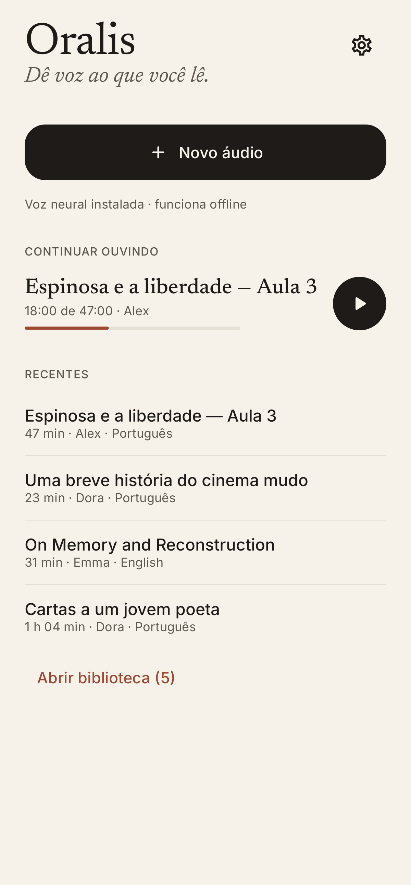

# Oralis

Estúdio pessoal de síntese de voz **offline** para Android. Transforma qualquer texto em um MP3
narrado pela voz neural **Kokoro‑82M**, executada inteiramente no aparelho.

> O Oralis não cria o conteúdo. Ele dá voz ao conteúdo que já existe.



## Funcionalidades

- Voz neural Kokoro‑82M local (MediaPipe Tasks Audio `TextToSpeech` + LiteRT‑LM), sem nuvem.
- Português do Brasil (Dora, Alex, Santa) e inglês britânico (Alice, Emma, Isabella, Lily,
  Daniel, Fable, George, Lewis) — vozes descobertas em tempo de execução via `listVoices()`.
- Amostra de voz e leitura do início do próprio texto, geradas localmente.
- Textos longos sem limite artificial: segmentação por parágrafos/frases, síntese sequencial,
  checkpoints em disco, retomada após interrupção, MP3 final validado frame a frame.
- Presets **Aula**, **Leitura** e **Noturno** (velocidade do modelo + pausas reais entre trechos).
- MP3 CBR 64/96/128 kbps (LAME 3.100), 24 kHz mono, com tags ID3 e cabeçalho Info (duração exata).
- Biblioteca (Room): busca, ordenação, favoritos, renomear, excluir, informações.
- Exportar para Downloads (MediaStore) ou qualquer pasta (SAF), compartilhar, abrir em outro app.
- Player Media3: segundo plano, notificação, tela de bloqueio, fones, ±10 s, velocidades
  0,75×–2×, memória de posição, "continuar ouvindo".
- Timer de sono (15–120 min ou personalizado) com fade‑out real nos últimos 20 s.
- Temas claro, escuro e automático. Sem conta, sem anúncios, sem telemetria, sem permissões de
  armazenamento.

## Arquitetura

```
app/src/main/java/app/oralis/
├── core/text/        TextSegmenter, SpeechTextPreparer, TextAnalysis (Kotlin puro, testado na JVM)
├── tts/              SpeechEngine (abstração), KokoroEngine, EngineHolder, VoicePreviewPlayer
├── model/            ModelVariant (hash oficial), ModelRepository, ModelDownloadWorker
├── generation/       GenerationPipeline (puro), GenerationWorker (WorkManager), GenerationRepository, ReadingPreset
├── audio/pcm/        PcmSegmentStore (checkpoints atômicos)
├── audio/mp3/        Mp3FileWriter (LAME via JNI), Mp3Inspector (validação independente)
├── playback/         PlaybackService (Media3), PlayerConnection, SleepTimer
├── data/             Room (AudioEntity/AudioDao), DataStore (Settings), ExportManager
├── notifications/    Canais e notificações
└── ui/               Compose: home, create, generation, library, player, settings (+ tema)
app/src/main/cpp/     LAME 3.100 (libmp3lame, LGPL) + ponte JNI oralis_mp3.c
tools/kokoro_host_server.py  Kokoro real no host para o teste de integração
```

### Pipeline: texto → MP3

1. O texto original é gravado **sem alterações** (`files/texts/<id>.txt`).
2. `TextSegmenter` divide em parágrafos → linhas → frases → trechos de até ~600 caracteres
   (cortes longos só em pontuação de oração ou espaço; nunca no meio de palavras). Cada trecho
   guarda os offsets no texto original.
3. `SpeechTextPreparer` gera a cópia técnica enviada ao motor (quebras de linha → espaço,
   remoção opcional de marcadores Markdown). Nenhuma palavra é alterada.
4. Cada trecho é sintetizado em ordem pelo Kokoro (24 kHz float) e salvo como PCM 16‑bit em
   `seg_NNNNNN.pcm` com escrita atômica (tmp + fsync + rename): a existência do arquivo é o
   checkpoint. Uma retomada pula trechos prontos — sem duplicar nem omitir.
5. Codificação em streaming (memória constante): pausas do preset + trechos, com ganho uniforme
   (pico ≤ −1 dBFS) → LAME → `.mp3.part`; o quadro Info/LAME é reescrito no fim.
6. `Mp3Inspector` percorre todos os frames e confere a duração esperada; só então o arquivo é
   renomeado e registrado na biblioteca. Arquivos incompletos nunca aparecem como prontos.

### Decisões técnicas

| Tema | Decisão | Motivo |
|---|---|---|
| Motor de voz | MediaPipe `tasks-audio:1.2.3` + `kokoro_int8_fp16.litertlm` | API oficial do Google AI Edge; o arquivo "universal" gera áudio limpo em CPU e GPU (o arquivo `_gpu_` fica ruidoso sem GPU e é opcional nas Configurações). |
| Origem do modelo | `huggingface.co/litert-community/Kokoro-82M`, revisão `bf1c2405…` fixada | Hash SHA‑256 oficial verificável (OID LFS; o mesmo do exemplo oficial do Google). |
| Aceleração | GPU com fallback automático para CPU | Mesmo comportamento do exemplo oficial; `uses-native-library` para OpenCL no Android 12+. |
| Encoder MP3 | LAME 3.100 compilado via NDK, biblioteca dinâmica | `MediaCodec` não tem encoder MP3; LAME é a referência de qualidade; LGPL cumprida com `.so` separado e código-fonte incluído. Sem FFmpegKit (descontinuado). |
| Tarefas longas | WorkManager com `setForeground` (`mediaProcessing` no Android 15+, `dataSync` antes) | Persistência e reexecução após morte do processo/reboot + checkpoints em disco. |
| Player | Media3 ExoPlayer + `MediaSessionService` | Notificação, tela de bloqueio, foco de áudio, fones. |
| Velocidade da voz | Recria o motor quando muda | Na API, `speakingRate` é opção do motor, não por enunciado. |

## Compilar

Requisitos: JDK 17+, Android SDK 36, NDK 28.2.13676358, CMake 3.31.6.

```sh
./gradlew :app:assembleDebug      # app/build/outputs/apk/debug/app-debug.apk
./gradlew :app:assembleRelease    # R8; assinado com a chave de debug (uso pessoal)
```

## Testes

```sh
./gradlew :app:testDebugUnitTest
```

- Segmentação e fidelidade (cobertura total, ordem, sem duplicatas, palavras nunca cortadas).
- MP3 real com LAME compilado para o host (mesmo código C do APK), duração exata, truncamento detectado.
- Pipeline com motor simulado: interrupção/retomada, invalidação de checkpoints, presets.
- `AppScreenshotTest`: inicia o app real no Robolectric e captura as telas (`docs/screenshots`).
- `RealKokoroPipelineTest`: pipeline completo com o **Kokoro real** no host:

```sh
python3 -m venv venv && venv/bin/pip install mediapipe==1.2.3 numpy
ORALIS_MODEL_PATH=/caminho/kokoro_int8_fp16.litertlm ORALIS_PYTHON=venv/bin/python \
ORALIS_LONG_MINUTES=30 ./gradlew :app:testDebugUnitTest --tests '*RealKokoroPipelineTest*'
```

## Licenças

Kokoro‑82M (Apache‑2.0), MediaPipe/LiteRT (Apache‑2.0), LAME 3.100 (LGPL‑2.0+; fonte em
`app/src/main/cpp/lame`), AndroidX/Media3 (Apache‑2.0), fontes Newsreader e Inter (SIL OFL 1.1).
